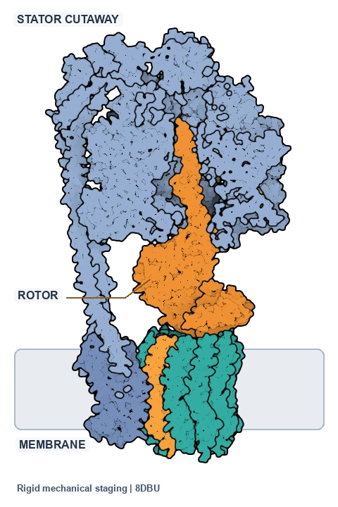
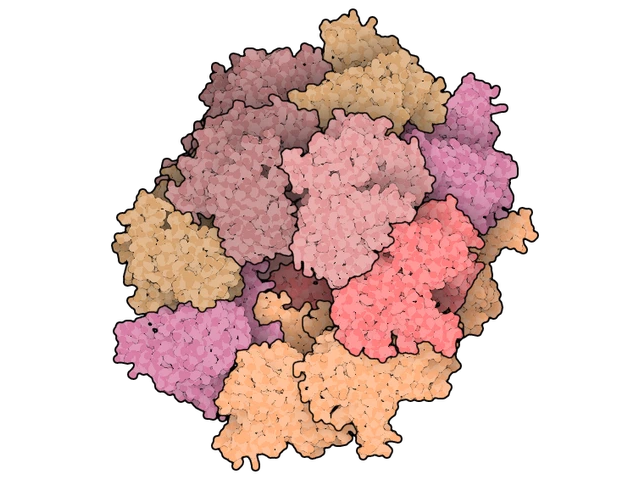
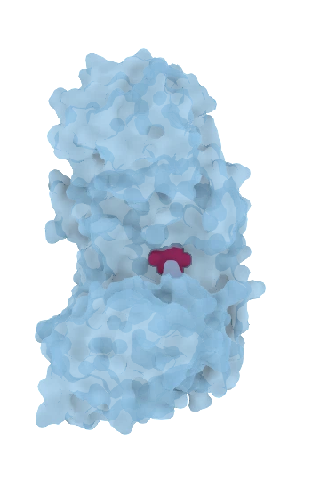
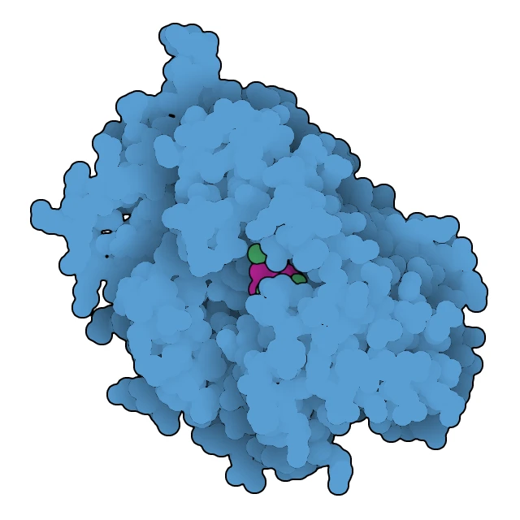
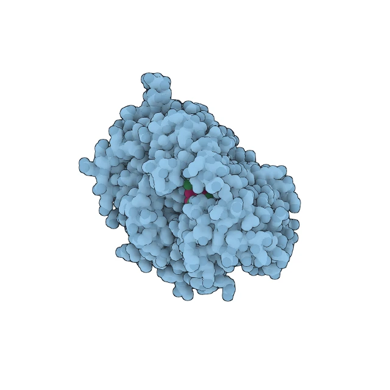

# protein-structure-animator

Reproducible native-tool workflows for protein illustrations and teaching animations, with structural choices, editable sources, and playback evidence documented.

Use the sibling goodsell-oxillustrate-rs native Rust renderer for canonical Goodsell figures and
animations, and Mol* for smooth molecular surfaces and interactive views.

<!-- screenshots:begin (managed by screenshot-docs) -->
## Animation gallery

### ATP synthase: see the motor

<a href="examples/atp_synthase_motor/README.md">
  <picture>
    <source media="(prefers-reduced-motion: reduce)"
      srcset="docs/screenshots/atp_synthase_motor_poster.webp">
    
  </picture>
</a>

ATP synthase couples rotation to ATP production. This authored Rust Goodsell
illustration turns the rotor against a fixed stator; a cutaway exposes the shaft. The camera stays
fixed. It illustrates neither measured kinetics, validated steric motion nor the full reaction.
Try: "Turn the ATP synthase rotor inside a fixed stator, exposing the shaft through a cutaway."
Reproduce: [examples/atp_synthase_motor/README.md](examples/atp_synthase_motor/README.md) |
[Transparent WebP](docs/screenshots/atp_synthase_motor.webp) |
[Static poster](docs/screenshots/atp_synthase_motor_poster.webp).

### GroEL: see the assembly

<a href="examples/groel_rotation/README.md">
  <picture>
    <source media="(prefers-reduced-motion: reduce)"
      srcset="docs/screenshots/groel_rotation_alpha_poster.webp">
    
  </picture>
</a>

The complete fourteen-subunit chaperonin provides a compartment for protein folding. This Rust
Goodsell loop changes viewpoint only; it shows neither GroES nor a folding cycle.
Try: "Rotate the complete GroEL assembly once, keeping its chain colors and a transparent background."
Reproduce: [examples/groel_rotation/README.md](examples/groel_rotation/README.md) |
[Transparent WebP](docs/screenshots/groel_rotation_alpha.webp) |
[Static poster](docs/screenshots/groel_rotation_alpha_poster.webp).

### Hexokinase: see the closure

<a href="examples/hexokinase_closure/README.md">
  <picture>
    <source media="(prefers-reduced-motion: reduce)"
      srcset="docs/screenshots/hexokinase_closure_alpha_poster.webp">
    
  </picture>
</a>

Hexokinase's lobes close around glucose: a teaching illustration of induced fit. This Mol* loop
interpolates experimental protein endpoints around a fixed, staged glucose
pose; it is not a measured binding path or a catalytic cycle.
Try: "Show hexokinase closing and reopening, with glucose visible through the surface."
Reproduce: [examples/hexokinase_closure/README.md](examples/hexokinase_closure/README.md) |
[Transparent WebP](docs/screenshots/hexokinase_closure_alpha.webp) |
[Static poster](docs/screenshots/hexokinase_closure_alpha_poster.webp).

All three transparent previews loop continuously over five seconds. Reduced-motion preferences
select matching static posters; the poster links also work independently. Each clip keeps one
fixed canvas and protein scale through the complete motion.

### Appearance options

These **static 3N0G stills** compare representation choices for the same isoprene synthase example.
Choose spheres for atom detail or a smooth surface for overall shape.

<p>
  <a href="examples/appearance_3n0g/README.md"></a>
  <a href="examples/appearance_3n0g/README.md"></a>
  <a href="examples/appearance_3n0g/README.md"></a>
</p>

In order: **Rust oxillustrate spheres** (canonical Goodsell), **Mol\* spheres**,
**Mol\* smooth surface**. Blue protein, contrasting ligand and magnesium retain the example palette.

Reproduce: [examples/appearance_3n0g/README.md](examples/appearance_3n0g/README.md).
<!-- screenshots:end -->

The [gallery capture record](docs/active_plans/reports/atp_synthase_gallery.md) records transparent
preview framing, timing and source preservation. Each README preview uses one fixed aspect ratio
at 12 fps; the native examples retain their separately documented canvases at 25 fps.

## What you can make

- Compare illustrated atom spheres with a smooth molecular surface using the 3N0G example.
- Show an explicitly staged interpolation between matched experimental hexokinase structures.
- Rotate the complete GroEL biological assembly without changing its coordinates.
- Illustrate an ATP synthase rotor turning inside a stationary cutaway housing.
- Render five-second MP4, GIF and animated WebP media, with transparent WebP, posters and native scenes.
- Reproduce the preparation, rendering, encoding, and verification steps from documented inputs.

## Quick start: render the GroEL assembly

This route uses the current sibling Rust checkout, FFmpeg, and repository Python with Pillow. Install Rust/Cargo, FFmpeg and Python 3, and place `goodsell-oxillustrate-rs` beside this checkout. From this repository root, build the external renderer, install Python dependencies and retrieve the fixed public inputs:

```bash
cargo build --release --manifest-path ../goodsell-oxillustrate-rs/Cargo.toml
source source_me.sh && python3 -m pip install --upgrade -r pip_requirements.txt
bash examples/download_inputs.sh
```

Render and encode the animation:

```bash
source source_me.sh && python3 examples/groel_rotation/render_oxillustrate.py
source source_me.sh && python3 tools/encode_loop.py output/groel_rotation_oxillustrate/frames
```

The verified Rust run writes `output/groel_rotation_oxillustrate/`, with `animation.mp4`,
`animation.gif`, `animation.webp`, `poster.webp`, 125 PNG frames and editable native JSON scenes.
The full-quality render is 640 x 640 pixels and five seconds at 25 fps. Downloaded input hashes are
checked by the download script. Fresh-process replay, structural checks and application playback
evidence are recorded separately in the
[integration ledger](docs/active_plans/workstreams/oxillustrate_integration.md).

## Choose an example

- [ATP synthase motor](examples/atp_synthase_motor/README.md): stage rotor motion against a stationary cutaway housing with a fixed camera and schematic membrane.
- [GroEL rotation](examples/groel_rotation/README.md): render the complete biological assembly and inspect its structural selections and rotation.
- [Hexokinase closure](examples/hexokinase_closure/README.md): prepare matched experimental structures with ChimeraX, then render the explicitly interpolated teaching illustration.
- [3N0G appearance comparison](examples/appearance_3n0g/README.md): render the canonical Rust still alongside the historical Fortran and Mol* comparison.

## Guides and evidence

- [Tool selection and installation](docs/TOOLS.md): choose a demonstrated native capability and install only the tools it needs.
- [Scientific and delivery checks](docs/ANIMATION_GUIDANCE.md): keep structural fidelity, interpretation, visual review, playback, and fresh-process reproduction distinct.
- [Canonical Goodsell rendering](docs/tools/OXILLUSTRATE.md): current Rust build, native CLI and scene contract.
- [Mol* rendering](docs/tools/MOLSTAR.md): smooth surfaces, interactive state and retained alternatives.
- [ChimeraX preparation](docs/tools/CHIMERAX.md): structural alignment and the checked trajectory handoff.
- [Media encoding](docs/tools/MEDIA.md): loop encoding and format-specific behavior.
- [Rust integration ledger](docs/active_plans/workstreams/oxillustrate_integration.md): accepted scope and separate verification evidence.
- [Historical toolbox verification](docs/active_plans/reports/toolbox_verification.md): earlier Mol*/Fortran acceptance and remaining limits.

## Requirements and limits

The GroEL quick start needs Rust/Cargo for the external renderer build, Python 3 with declared dependencies, and FFmpeg. Node.js and Playwright Chromium are needed for the retained Mol* route. The appearance and hexokinase examples need their separately documented tools. ChimeraX is distributed under separate terms that distinguish noncommercial and commercial use; check its current license for your use. No external application is bundled. Tested versions and specific software behavior are recorded in the examples and reports.

The hexokinase illustration places closed-state glucose in the open-state structure, where a short
contact is documented; its intermediate conformations are geometric constructs. ATP synthase uses
authored rigid rotor motion with a stator cutaway; it establishes neither steric clearance, kinetics
nor a catalytic cycle. GroEL shows the deposited construct and a viewpoint rotation. Use MP4 for the verified Impress slideshow route;
earlier Mol* animated WebP image insertion was blank. Read each example's structure and limitation
notes before reusing its media scientifically.

## Licenses

Project source code is [LGPL-3.0](LICENSE.LGPL-3.0). Documentation, example materials, and generated previews are [CC-BY-4.0](LICENSE.CC-BY-4.0). The external Rust renderer is AGPL-3.0-only and is not bundled or relicensed here. Mol* is MIT licensed; other native tools and structural data retain their own terms, as noted in the guides.

## Project notes

- [Human guidance](docs/HUMAN_GUIDANCE.md): teaching and practical priorities.
- [Design decisions](docs/DESIGN_DECISIONS.md): settled direction for this collection.
- [Changelog](docs/CHANGELOG.md): repository changes and verification notes.
