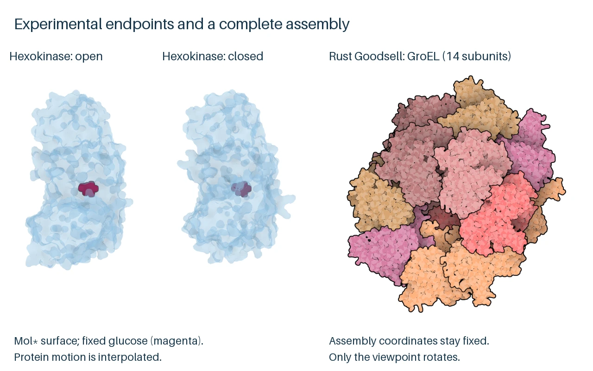
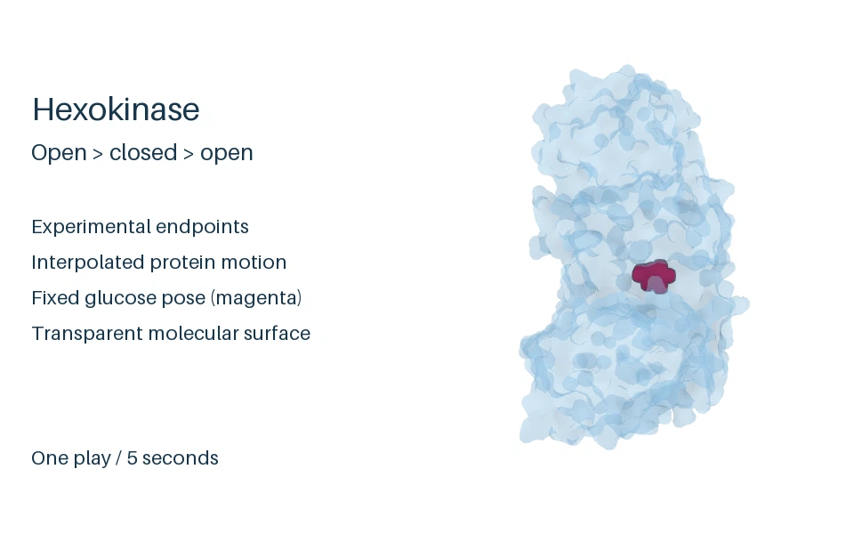

# protein-structure-animator

Reproducible native-tool workflows for protein illustrations and teaching animations, with structural choices, editable sources, and playback evidence documented.

Use the sibling goodsell-oxillustrate-rs native Rust renderer as the canonical renderer and visual gold standard for Goodsell figures and animations. The first integration covers the 3N0G still and complete GroEL rotation; its rendering, replay and independent scientific evidence are tracked separately from the accepted earlier toolbox examples. Mol* remains available for smooth surfaces and interactive views. The existing hexokinase interpolation stays unchanged.

## Screenshots

The hexokinase source animation illustrates closure and reopening around a fixed, experimentally positioned glucose pose. Its 125 distinct source frames at 25 fps make a five-second loop; the motion is endpoint interpolation, not a physical binding path or kinetics model. The static comparison pairs those Mol* hexokinase endpoints with the canonical Rust Goodsell GroEL view of all fourteen chains. GroEL changes viewpoint only. The README animated WebP is the unchanged one-play, reduced-rate hexokinase preview.

<!-- screenshots:begin (managed by screenshot-docs) -->


<!-- screenshots:end -->

The [Rust capture record](docs/active_plans/reports/oxillustrate_capture.md) documents the refreshed static proof and byte-identical hexokinase preview. New Rust GroEL media passed actual Chromium WebP/GIF/MP4 playback and LibreOffice Impress MP4 slideshow motion checks. Earlier Mol* outputs also passed browser GIF/MP4/WebP and Impress GIF/MP4 checks; their animated WebP inserted as an ODP image was blank. That older WebP limitation was not retested for Rust media. Exact Impress frame timing was not measured.

## What you can make

- Compare illustrated atom spheres with a smooth molecular surface using the 3N0G example.
- Show an explicitly staged interpolation between matched experimental hexokinase structures.
- Rotate the complete GroEL biological assembly without changing its coordinates.
- Render five-second, 640 x 640 media as MP4, GIF, and animated WebP, with posters and editable native scenes.
- Reproduce the preparation, rendering, encoding, and verification steps from documented inputs.

## Quick start: render the GroEL assembly

This route uses the current sibling Rust checkout, FFmpeg, and repository Python with Pillow. Install Rust/Cargo, FFmpeg and Python 3, and place `goodsell-oxillustrate-rs` beside this checkout. From this repository root, build the external renderer, install Python dependencies and retrieve the fixed public inputs:

```bash
cargo build --release --manifest-path ../goodsell-oxillustrate-rs/Cargo.toml
source source_me.sh && python3 -m pip install --upgrade -r pip_requirements.txt
bash examples/download_inputs.sh
```

Render and encode the animation:

```bash
source source_me.sh && python3 examples/groel_rotation/render_oxillustrate.py
source source_me.sh && python3 tools/encode_loop.py output/groel_rotation_oxillustrate/frames
```

The verified Rust run writes `output/groel_rotation_oxillustrate/`, with `animation.mp4`, `animation.gif`, `animation.webp`, `poster.webp`, 125 PNG frames and editable native JSON scenes. The verified render is 640 x 640 pixels and five seconds at 25 fps. A fresh-process replay reproduced the frames and media byte-for-byte on this Mac; rendering took 54.08 seconds and encoding 17.67 seconds. Independent native identity and geometry checks pass. Chromium playback of WebP, GIF and MP4, including a natural MP4 loop, and actual Impress MP4 slideshow motion passed. Fresh specification, quality and integration reviews passed; separate evidence and limits remain in the [integration ledger](docs/active_plans/workstreams/oxillustrate_integration.md). Downloaded input hashes are checked by the download script. Dependency minimums are open-ended; tested revisions and versions are observations, not pins.

## Choose an example

- [GroEL rotation](examples/groel_rotation/README.md): render the complete biological assembly and inspect its structural selections and rotation.
- [Hexokinase closure](examples/hexokinase_closure/README.md): prepare matched experimental structures with ChimeraX, then render the explicitly interpolated teaching illustration.
- [3N0G appearance comparison](examples/appearance_3n0g/README.md): render the canonical Rust still alongside the historical Fortran and Mol* comparison.

For example, a request that fits the current collection is: "Show the complete GroEL assembly rotating once, with the chain colors and white background used in the documented example, and save editable native JSON scenes plus MP4 and GIF." The GroEL example changes the camera viewpoint only; it does not depict a conformational cycle.

## Guides and evidence

- [Tool selection and installation](docs/TOOLS.md): choose a demonstrated native capability and install only the tools it needs.
- [Scientific and delivery checks](docs/ANIMATION_GUIDANCE.md): keep structural fidelity, interpretation, visual review, playback, and fresh-process reproduction distinct.
- [Canonical Goodsell rendering](docs/tools/OXILLUSTRATE.md): current Rust build, native CLI and scene contract.
- [Mol* rendering](docs/tools/MOLSTAR.md): smooth surfaces, interactive state and retained alternatives.
- [ChimeraX preparation](docs/tools/CHIMERAX.md): structural alignment and the checked trajectory handoff.
- [Media encoding](docs/tools/MEDIA.md): loop encoding and format-specific behavior.
- [Rust integration ledger](docs/active_plans/workstreams/oxillustrate_integration.md): accepted scope and separate verification evidence.
- [Historical toolbox verification](docs/active_plans/reports/toolbox_verification.md): earlier Mol*/Fortran acceptance and remaining limits.

## Requirements and limits

The GroEL quick start needs Rust/Cargo for the external renderer build, Python 3 with declared dependencies, and FFmpeg. Node.js and Playwright Chromium are needed for the retained Mol* route. The appearance and hexokinase examples need their separately documented tools. ChimeraX is distributed under separate terms that distinguish noncommercial and commercial use; check its current license for your use. No external application is bundled. Tested versions and specific software behavior are recorded in the examples and reports.

The hexokinase illustration places closed-state glucose in the open-state structure, where a short contact is documented; its intermediate conformations are geometric constructs. GroEL shows the deposited construct and a viewpoint rotation, not folding dynamics. The earlier Mol* animated WebP did not display through the tested Impress image insertion route. Read each example's structure and limitation notes before reusing its media scientifically.

## Licenses

Project source code is [LGPL-3.0](LICENSE.LGPL-3.0). Documentation, example materials, and generated previews are [CC-BY-4.0](LICENSE.CC-BY-4.0). The external Rust renderer is AGPL-3.0-only and is not bundled or relicensed here. Mol* is MIT licensed; other native tools and structural data retain their own terms, as noted in the guides.

## Project notes

- [Human guidance](docs/HUMAN_GUIDANCE.md): teaching and practical priorities.
- [Design decisions](docs/DESIGN_DECISIONS.md): settled direction for this collection.
- [Changelog](docs/CHANGELOG.md): repository changes and verification notes.
